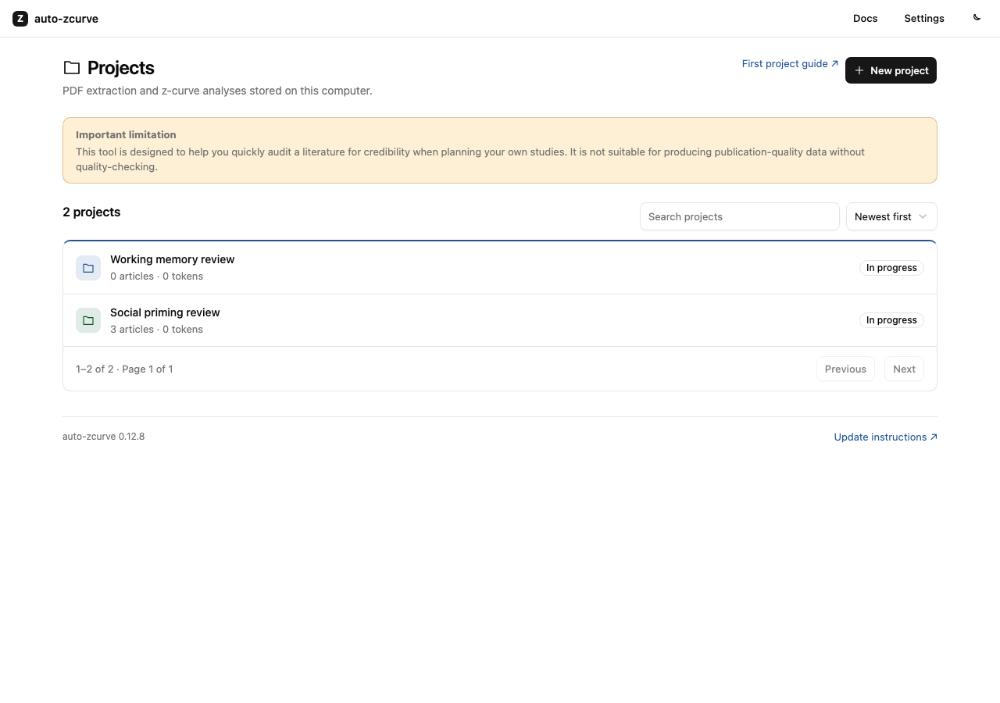
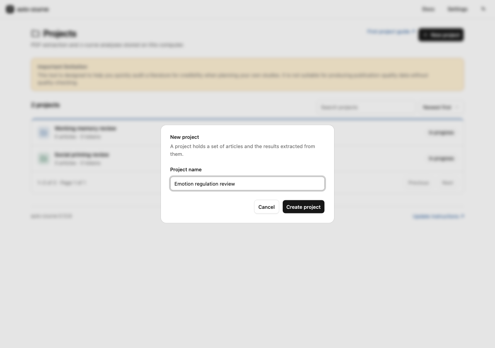
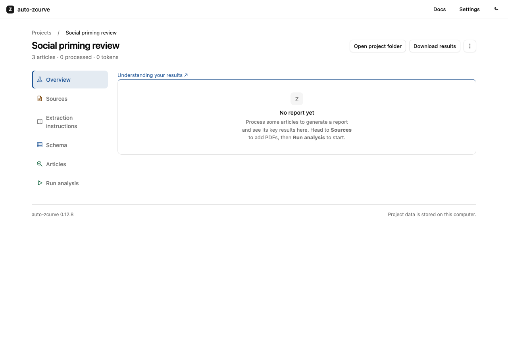
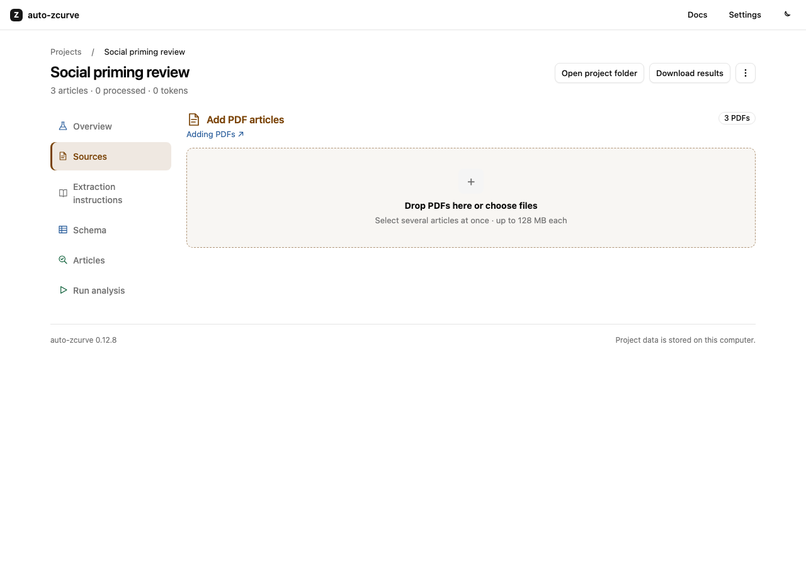
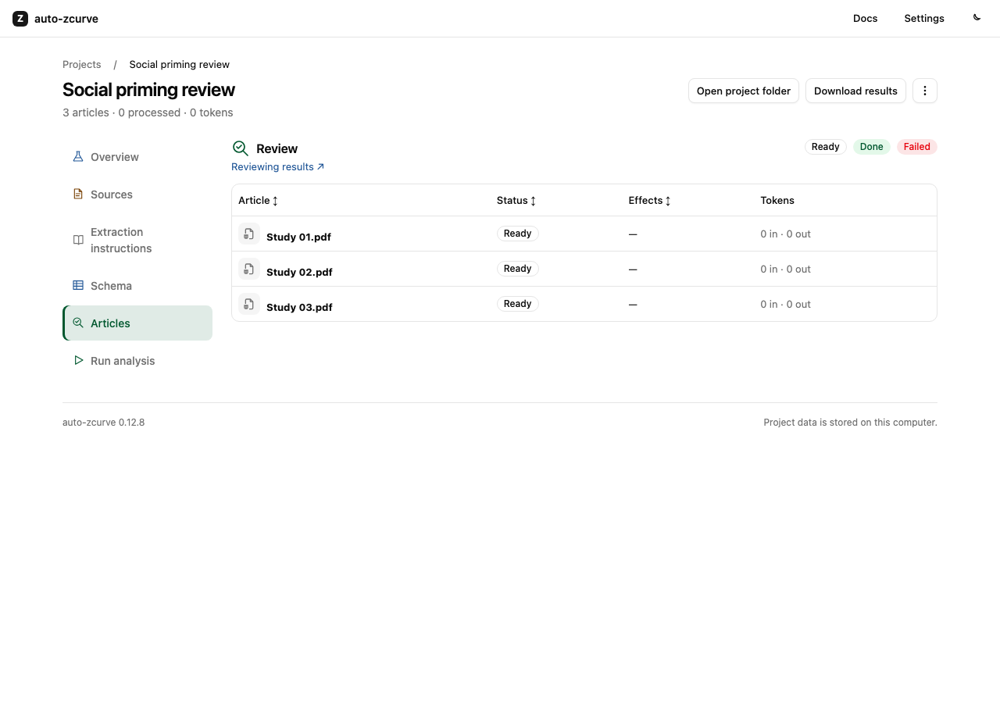
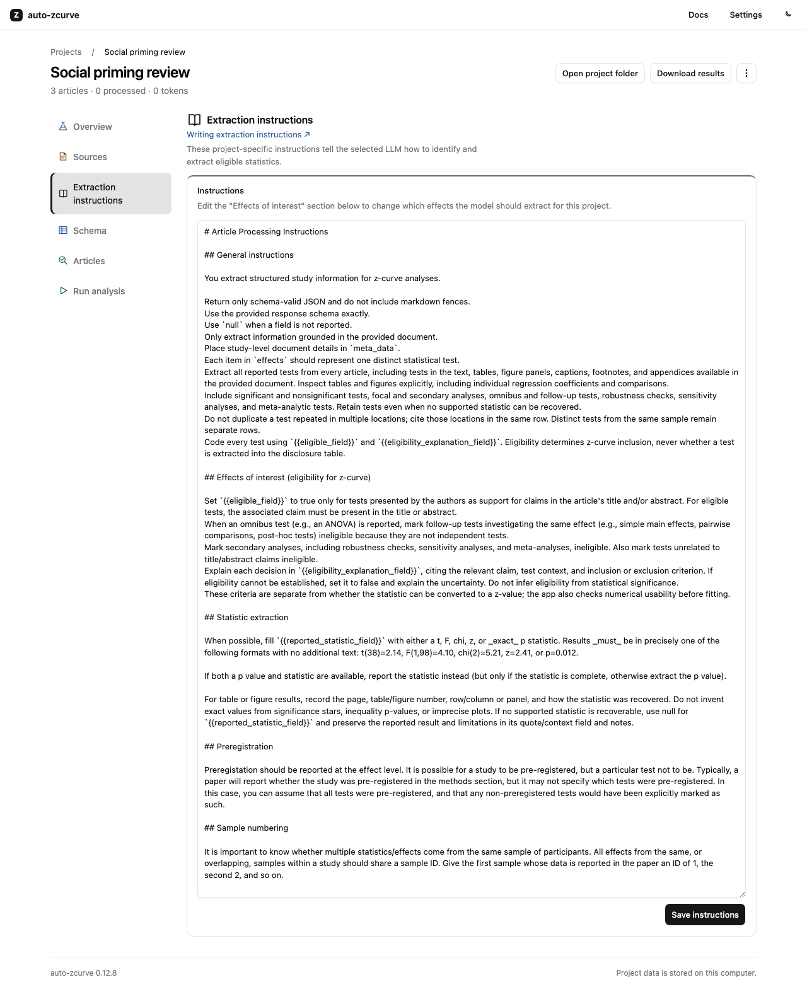
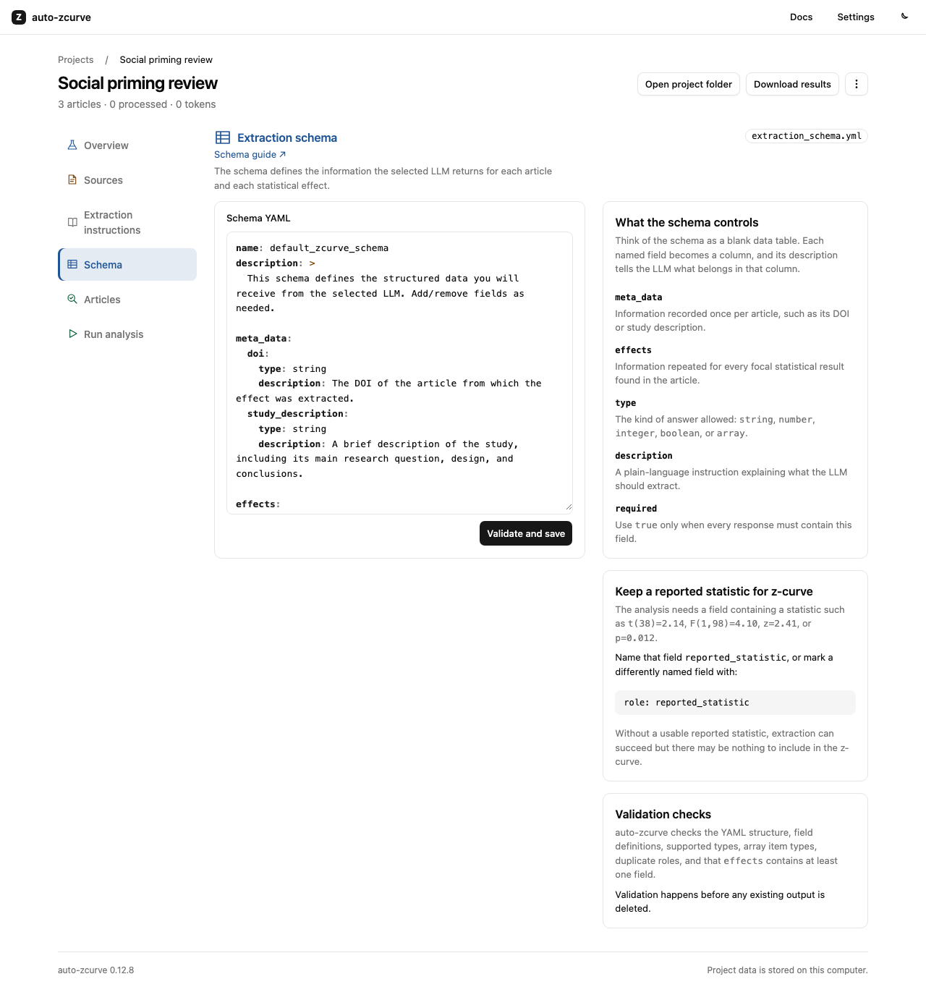

# Your first project

This walks through a full run: creating a project, adding articles, checking
the extraction setup, creating an extractor with your API key, running the analysis, and finding
your results.

## 1. Create a project

Open auto-zcurve in your browser. The **Projects** page lists everything
you've created so far. Search by name, sort newest first, oldest first, or
A–Z, and use **Previous** and **Next** to move through pages of ten projects.

Click **New project** and give it a short, descriptive name — you can rename
it later from the project page.

You land on the new project's page, with an empty **Overview** tab. Use the
left-hand navigation to move through the workflow. On narrow screens, these
controls appear above the content.

## 2. Add your articles

Open the **Sources** tab and drag your articles into the drop zone, or click
it to choose files from your computer. You can add several at once. Articles
can be PDFs or publisher XML files (`.xml`), and one project can mix both.

Once added, each article is listed as **Ready** on the **Articles** tab.
Nothing is sent anywhere yet — this just registers the files in your project.

!!! note "XML articles"
    auto-zcurve does not convert or tidy XML. When you run the analysis, the
    file's full contents are sent to the AI model as UTF-8 text, unparsed and
    unshortened, with every provider. Some things to know:

    - **Text only.** Images, and any supplementary files the XML only links
      to, are not available to the model.
    - **Locations instead of pages.** XML has no page numbers, so quotes cite
      a section heading or a table row and column, for example
      *(Results › Study 2)* or *(Table 3, row "Extraversion", column "r")*.
    - **Size limit.** Publisher XML is long: a typical journal article is
      about 50,000–100,000 tokens. If the selected model's known context
      window is clearly too small, the article fails with a message such as
      "Article is ~280k tokens; this model accepts 128k". It is never
      shortened to fit. Choose a model with a larger context window and
      retry it.
    - **Format.** The file must be UTF-8 text that starts with `<`.
      Empty files, binary files and other formats are rejected when you add
      them.

## 3. Check the extraction instructions

The **Extraction instructions** tab holds the plain-language instructions the
AI model follows when deciding what counts as an eligible statistic in your
articles. Sensible defaults are pre-filled; read through them and adjust the
wording if you want to extract the test for a particular phenomenon. Saving
changed instructions after a run clears its current outputs so the articles
can be processed again; the source files remain.

## 4. Check the extraction schema

The **Schema** tab defines exactly what information comes back for each
article — think of it as a blank spreadsheet, where each field you list
becomes a column. The default schema already includes a
`reported_statistic` field, which is what feeds the z-curve analysis, so you
usually don't need to change this for a first run. Add fields here if you
also want the AI model to record something else about every effect (for
example, the sample size or the exact page number). Saving a changed schema
also clears existing extraction outputs and reports while keeping the source
files.

## 5. Create an extractor

An extractor tells auto-zcurve which model to use and holds its API key. Open
**Settings** from the top bar and click **Add extractor**. Give it a name,
keep the **Gemini** provider, enter a model ID such as `gemini-3.6-flash`,
paste your key into **API key**, and click **Save extractor**. See
[API keys and privacy](api-key.md) for how to get a key and where it is kept.

You can also create extractors for OpenRouter or an
[OpenAI-compatible endpoint](settings.md#openai-compatible); a keyless server
does not need an API key.

## 6. Run the analysis

Back in your project, open the **Run analysis** tab. Choose your extractor
from the **Extractor** list; the page shows its settings. Click
**Run analysis**. To process articles faster or change the model, edit the
extractor in [Settings](settings.md#extractors).

auto-zcurve processes each article in turn (or in parallel, if you raised that
setting), shows live progress, and lets you know if any article fails —
failures can usually be retried without reprocessing the articles that
already succeeded.

## 7. Review your report

Once processing finishes, the **Overview** tab shows the z-curve plot, key
estimates with confidence intervals, and a short written summary. From
there you can open the full report, or use **Download results** at the top
of the page to get a ZIP of everything — see
[Understanding your results](results.md) for what's inside.

## Next step

See [Understanding your results](results.md) to make sense of the report,
or [FAQ and troubleshooting](faq.md) if something didn't go as expected.
