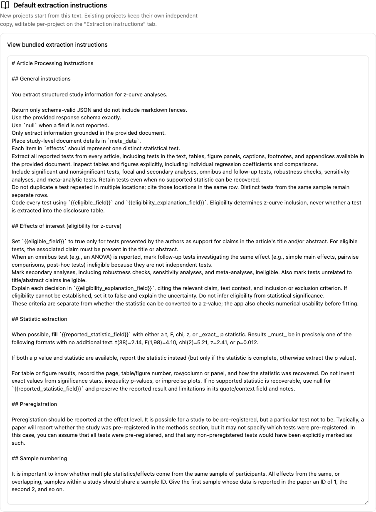

# Settings and extractors

Open **Settings** in the top bar. The sidebar links to **Extractors**,
**Files and parsing**, and the bundled extraction instructions. On a narrow
screen, this navigation appears above the settings.

## Extractors

An **extractor** is a saved setup for reaching a model: a name, a provider, a
model, an API key, and request settings. Each project chooses one extractor on
**Run analysis**, and every run and retry uses exactly its settings.

You can keep as many extractors as you like, including several for the same
provider. For example, two Gemini extractors can use different API keys, or
the same key with a different model or service tier.

The list shows each extractor's provider, model, and whether its key is saved.

- **Add extractor** opens a dialog to create one.
- **Edit** opens the same dialog with the saved settings. The provider can't
  be changed; create a new extractor to use another provider.
- **Duplicate** copies every setting except the API key, under a new name.
- **Delete** removes the extractor and its saved key. Projects that used it
  ask you to choose another extractor before their next run.

### Settings every extractor has

| Setting | What it does |
| --- | --- |
| Name | How the extractor appears in projects. Names must be unique. |
| Provider | Gemini, OpenRouter (Experimental), or OpenAI-compatible. |
| Model | The exact model ID. |
| Parallel articles | How many articles are processed at once (1–32, default 1). |
| Delay between requests | Minimum seconds between request starts (default 0). |
| Request timeout | Seconds allowed for one request (default 600). |
| API key | Optional when creating; see [API keys and privacy](api-key.md). |

For Gemini and OpenRouter, creating an extractor with a key, or changing its
model on an edit, asks the provider whether the model can be used with that
key, and refuses a model it doesn't recognise. Without a key, the extractor is
saved and the model is checked when it first runs. For Gemini and OpenRouter,
**Show available models** loads the provider's model list as suggestions,
using the extractor's saved key or, before one is saved, the key typed into
the form (sent for that one request only, never stored). OpenRouter's list
loads without a key. Suggestions load only when you click the button.
OpenAI-compatible servers have no model catalog here: the model ID is passed
to the configured server as entered, and the server reports a model it
doesn't know.

### Gemini

**Service tier** chooses between Flex (lower cost, variable latency),
Standard, and Priority (higher cost, lower latency). Gemini receives the
original PDF.

### OpenRouter (Experimental)

Enter an exact OpenRouter model ID, such as `vendor/model`. The model must
support strict structured outputs. PDF processing uses OpenRouter's
file-parser service.

- **Reasoning effort** is sent when the model supports reasoning. Higher
  effort can improve accuracy, at more cost and latency.
- **Route to provider** pins the provider that serves the model, such as
  `deepinfra/fp8`. After you choose a model, the field suggests the providers
  that currently serve it with structured output. Leave it empty to let
  OpenRouter choose. Providers can run different quantizations of the same
  model, so pinning one keeps results consistent.
- **Fallbacks** controls what happens when that provider is unavailable.
  **Allow other providers** retries elsewhere. **Don't fall back** fails the
  request instead, so every result comes from the provider you chose.

### OpenAI-compatible

Connect a hosted or local server that supports Chat Completions.

1. Enter its **API base URL**, including its API prefix, for example
   `http://localhost:8000/v1`. Do not append `/chat/completions`,
   credentials, a query string, or a fragment.
2. Enter the exact **Model** ID the server serves.
3. Choose a **JSON output mode** the server supports.
4. Optionally enter the model's **Context length** in tokens, so XML and PDF
   articles that are clearly too long fail before they are sent.
5. Add an API key only if the server requires one.

| JSON output mode | What the app requests |
| --- | --- |
| Strict JSON schema | A `json_schema` response format with the extraction schema. |
| JSON object | A `json_object` response format, with the schema also in the prompt. |
| Prompt only | JSON requested in the prompt, without a response-format parameter. |

Every response is checked against the project's extraction schema, including
responses from prompt-only mode. PDFs are converted locally to text with page
numbers before being sent. Figures are not included. Scanned PDFs need OCR
first; a PDF with no extractable text fails with an explanatory message.

## Choosing an extractor for a project

On a project's **Run analysis** tab, choose an extractor from the
**Extractor** list. The choice is saved for the project straight away, and
the page shows that extractor's settings. **Edit extractor** opens it in
Settings.

**Run analysis** and **Retry** are available once the chosen extractor has a
key, or needs none. The next run reprocesses every article if the extractor's
provider or model changed, or any setting that changes how articles are
sent: the reasoning effort or route to provider and fallbacks (OpenRouter),
the service tier (Gemini), or the API base URL, JSON output mode, or context
length (OpenAI-compatible). Changing the PDF parser does the same.

Each run records the extractor it used, and a copy of its settings, in the
project. Results and run logs name the extractor that produced each article,
so editing or deleting an extractor later doesn't change what past results
say about how they were made.

## Files and parsing

These settings apply to every project:

- **Maximum file size**, in megabytes, applied when files are uploaded.
- **PDF parser**, how PDF content is prepared before it reaches the model. It
  does not change the OpenAI-compatible provider's local text input, and it
  does not apply to XML articles, which are always sent as text.

Click **Save settings** to save them.

## Default extraction instructions

Expand **View bundled extraction instructions** to read the starting text.
This view is read-only. Each project has an independent editable copy under
**Extraction instructions** in its left-hand navigation. See
[customising the extraction instructions](quickstart.md#3-check-the-extraction-instructions).

## Upgrading from an earlier version

The first time this version starts, it turns your existing provider setup into
extractors, using the previous default model and settings. An extractor is
created for:

- **Gemini**, if it had a saved key, or a default model or service tier other
  than the old defaults.
- **OpenRouter**, if it had a saved key or a default model.
- **OpenAI-compatible**, if it had a saved key or an API base URL.

Any other setting changed on its own, such as OpenRouter reasoning effort
without a saved key or model, isn't carried over. Saved keys move into the new
key storage the first time a key is needed.

!!! warning "The upgrade can't be undone"
    The old settings are removed and old saved keys are deleted once they
    have moved. If you go back to an earlier version, re-enter your keys and
    default models there.

Every saved key gets an extractor, so no old key is left behind. If its
earlier settings are missing or unusable, for example an OpenAI-compatible key
saved without an API base URL, the extractor keeps the key and shows the
missing setting as **Not set**. Edit it to enter the model and, for
OpenAI-compatible, the API base URL before running it. Delete the extractor
if you no longer need that key. Projects whose last run used the
same provider and model as one of these extractors select it automatically;
others ask you to choose one.

API keys are no longer read from environment variables such as
`GEMINI_API_KEY`, or from `.env` files. Add each key to an extractor instead.
